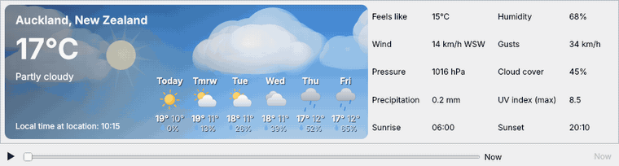

# RBSB-Weather 2.1.0

*Formerly **WeatherDesk**. Renamed in 2.0.0 because "WeatherDesk" is used by many
other apps; nothing else changed, and your settings come with you (see
[Coming from WeatherDesk](#coming-from-weatherdesk)).*

A desktop weather app for Linux Mint (and other Ubuntu 24.04-based systems).
It shows current conditions, a 24-hour chart, a 7-day forecast, and the
temperature in your system tray. It uses the free Open-Meteo service, with
MET Norway (yr.no) as an automatic backup, so you don't need an account or an
API key. If you like, Settings → Weather Providers adds OpenWeather,
WeatherAPI.com, Visual Crossing, Tomorrow.io or Weather Underground (with a
personal weather station key) using your own API key, as the primary provider
or as backups.

**Created By Shane BlackbuRn**

*Shane's design and Claude's coding.* Every feature started as Shane's idea and
design; Claude (Anthropic's AI) wrote the code and the tests to his spec.



*Forecast playback: press play and the next 24 hours run in the animated sky
(afternoon showers and a thunderstorm, a clear night with stars and the Moon,
dawn fog, then sunshine). Recorded from RBSB-Weather itself with sample forecast
data.*

## Features

* Search for any city or town worldwide; save up to 50 locations and reorder them.
* Current conditions: temperature, feels-like, humidity, wind and direction,
  gusts, pressure, cloud cover, precipitation, UV index, and sunrise/sunset.
* An animated, realistic sky: the sky colour follows the local time of day,
  the sun and moon rise at the bottom left, arc across the sky and set at
  the bottom right at their real times, the moon shows its real phase (and is
  visible by day whenever it's really up), clouds drift
  with the wind, and there's rain, snow, fog and lightning.
* A mini forecast of 1–7 days, with animated icons, high/low and rain chance,
  in the bottom-right of the animated sky. It adapts to the space and stays
  put, with the setting sun or moon passing behind it.
* A floating desktop widget with the same animated sky, the temperature and
  when it was last updated.
* A Moon tab with a high-resolution picture of the current phase (correct
  for your hemisphere), moonrise and moonset, upcoming phases, and the next
  7 days. It's calculated on your computer, so it works offline, and you can
  save the moon as a 2048 px image.
* Earth Flat and Earth Globe tabs with the live day/night Earth, as a map or
  as a globe you can drag to spin. Each saved location shows its local time,
  whether it's day, twilight or night there, its temperature and an animated
  weather icon. Click a marker to select that place; the globe turns to face it.
  The globe zooms (wheel, +/−), and the real Sun, Moon (with its phase) and
  stars sit behind it, moving as it turns.
* Live satellite clouds on both Earth tabs, updated every 3 hours: white over
  the day side, hiding city lights at night.
* A 24-hour chart of temperature with the chance of precipitation.
* A 7-day forecast with high/low temperature, rain chance and amount, and wind.
* °C/°F, km/h · m/s · mph · knots, mm/inches, and a 12- or 24-hour clock.
  Switching is instant.
* Auto-refresh every 10–120 minutes, or turned off.
* Forecast playback: play or scrub the next 24 hours in the animated sky,
  with that hour's weather, Sun and Moon.
* Every saved location updates when RBSB-Weather starts (including at login),
  one at a time, with retries if the network isn't up yet after a boot.
* A tray icon showing the live temperature, with optional close-to-tray and
  start at login.
* Offline fallback: the last forecast for each location is saved and shown,
  clearly labelled, when there's no internet.
* Single instance: launching it a second time brings the existing window forward.
* Checks for updates once a day (Settings to turn it off; Help → Check for
  Updates to check now). A new version is downloaded, checked against its
  checksum and opened in your package installer; nothing installs without you.
* The in-app User Guide is under Help → User Guide (F1).

## Install

```bash
sudo apt install ./rbsb-weather_2.1.0_all.deb
```

`apt` pulls in `python3-pyqt6` automatically. Launch **RBSB-Weather** from the
menu (it's under Accessories), or run `rbsb-weather` from a terminal.

To verify the download first:

```bash
sha256sum -c SHA256SUMS
```

## Update

From 2.1.0 the app tells you when there's a newer version and can download it
for you (Help → Check for Updates). Or install the newer .deb the same way. Your settings and saved forecasts in
`~/.config/rbsb-weather` and `~/.cache/rbsb-weather` are kept, and so are API
keys (in the keyring, or `~/.config/rbsb-weather/keys.json`). Then open
RBSB-Weather: if an older copy is still running (for example in the tray), it
closes itself cleanly and the new version takes over. From 1.1.1 on this is
automatic; before that you had to quit the old copy first.

## Coming from WeatherDesk

Install RBSB-Weather (2.0.0 or later) as above. It replaces the old `weatherdesk` package
(apt removes it for you) and the first time RBSB-Weather starts it carries over:

* settings and saved locations (`~/.config/weatherdesk` → `~/.config/rbsb-weather`)
* saved forecasts (`~/.cache/weatherdesk` → `~/.cache/rbsb-weather`)
* API keys, whether they're in the system keyring or in `keys.json`
* "Start at login", if you had it on
* a WeatherDesk that's still running in the tray closes itself and RBSB-Weather
  takes over

Everything is copied, not moved: the old folders are left as they were, so you
can go back to a WeatherDesk package if you want to. The `weatherdesk` command
still works (it starts RBSB-Weather), and searching the menu for "weatherdesk"
still finds it. Once you're happy, you can delete the old folders:
`rm -rf ~/.config/weatherdesk ~/.cache/weatherdesk`.

To go back to WeatherDesk: `sudo apt install ./weatherdesk_1.18.0_all.deb` (this
removes rbsb-weather). Your WeatherDesk settings are as they were before the
upgrade; changes made in RBSB-Weather since then stay in RBSB-Weather's folder.
If you use "Start at login", turn it on again in WeatherDesk.

## Roll back / uninstall

```bash
sudo apt install ./rbsb-weather_<older-version>_all.deb   # roll back
sudo apt remove rbsb-weather                                # uninstall
rm -rf ~/.config/rbsb-weather ~/.cache/rbsb-weather          # optional: remove your data
rm -f ~/.config/autostart/rbsb-weather.desktop              # if "Start at login" was on
```

Rolling back keeps your locations, units and API keys. Versions before 1.13
don't know about weather providers, so if you run one, the provider order and
Weather Underground Station ID go back to the defaults; set them again after
upgrading. From 1.15.0 on, settings a newer version added are kept.

## Run from source

```bash
sudo apt install python3-pyqt6
python3 -m rbsb_weather            # from the project folder
```

Options: `--minimized` starts in the tray, `--verbose` turns on debug
logging, and `--version` prints the version.

## Tests

```bash
./run_tests.sh
```

The tests run fully offline against local fake weather servers. They
cover parsing for all seven providers (including damaged and hostile replies),
fallback and recovery, API-key safety, network error paths, settings and cache
safety, complete GUI workflows, packaging, and stress, leak and soak checks.
They don't contact the real weather services, so they show that RBSB-Weather
handles each service's documented format, not that the live service still
sends it. The full log is written to
`test-results.log`. See `TEST_REPORT.md` for the latest results.

## Build the package

```bash
./build_deb.sh     # -> dist/rbsb-weather_<ver>_all.deb, source tar.gz, SHA256SUMS
```

## Project layout

| Path | Purpose |
|---|---|
| `rbsb_weather/api.py` | Open-Meteo client, response parsing, retries and the automatic backup (standard library only) |
| `rbsb_weather/metno.py` | MET Norway client: the second weather source |
| `rbsb_weather/providers/` | Weather providers: one module per service, the registry, the common-format normaliser and the ProviderManager (fallback chain, recovery, quota guards, status) |
| `rbsb_weather/providers_dialog.py` | Settings → Weather Providers |
| `rbsb_weather/keystore.py` | API key storage (system keyring or a 0600 file) and log redaction |
| `rbsb_weather/sun.py` | Sunrise/sunset, day/night and "feels like" for providers that don't supply them |
| `rbsb_weather/storage.py` | Settings and forecast cache (atomic JSON writes) |
| `rbsb_weather/workers.py` | Background network threads |
| `rbsb_weather/main_window.py` | The main window, tray, and menus |
| `rbsb_weather/widgets.py` | 24-hour chart and tray icon drawing |
| `rbsb_weather/scene.py` | Animated weather scenes, icons, and the shared animation clock |
| `rbsb_weather/desktop_widget.py` | Floating desktop widget |
| `rbsb_weather/moon.py` | Moon phase, illumination, rise/set (Meeus) |
| `rbsb_weather/moon_render.py`, `moon_panel.py` | Moon images and the Moon tab |
| `tools/make_moon_texture_nasa.py` | Build moon images from NASA's CGI Moon Kit |
| `tools/make_moon_texture.py` | Generated fallback moon images |
| `rbsb_weather/earth.py`, `earth_panel.py` | Sun position, day/night map blending, Earth Flat tab |
| `rbsb_weather/clouds.py` | Live cloud map download, cache and blending |
| `rbsb_weather/forecast_strip.py` | The mini forecast in the sky: adaptive layout, keeping clear of text and the Sun/Moon, drawing |
| `rbsb_weather/sky.py` | Sun, Moon and stars behind the globe (positions, Moon orientation) |
| `rbsb_weather/globe.py`, `globe_panel.py` | Globe projection and drawing (numpy or pure Python), Earth Globe tab |
| `rbsb_weather/net.py` | Fast IPv4/IPv6 connection racing |
| `rbsb_weather/diagnostics.py` | Help → Test connection |
| `rbsb_weather/updates.py`, `update_dialog.py` | Check for updates: GitHub's latest release, verified download, the update window |
| `rbsb_weather/migrate.py` | Carrying a WeatherDesk user's settings, keys and login entry over to RBSB-Weather (2.0.0) |
| `rbsb_weather/units.py`, `weather_codes.py` | Unit conversion and weather descriptions |
| `tests/` | Test suite and fake server |
| `packaging/` | Launcher, .desktop file, and icon |

## Adding a weather provider

1. Create `rbsb_weather/providers/<name>.py` with a class derived from
   `Provider` and decorated with `@register`:
   * `info = ProviderInfo(...)`: id, name, whether it needs a key, website,
     credit, coverage, forecast days, hourly, limits, the features it supplies,
     sign-up and documentation links, and `min_interval_s` if its free
     allowance is small;
   * `default_base_url()`;
   * `_fetch(location, days)`: request the data (the key is `self.api_key`),
     convert it to a `Forecast`: WMO weather codes, °C, km/h, mm, hPa, %, and
     local times as `YYYY-MM-DDTHH:MM`. Leave anything the service doesn't
     supply as `None`;
   * optionally `_error_reason(body)` and `usage()`.
2. Import the module in `rbsb_weather/providers/__init__.py`.
3. Add its documented response shape to `tests/provider_fixtures.py` and its
   tests to `tests/test_providers.py`.

The normaliser, fallback, key storage, Settings dialog, connection test and
the rest of the app need no changes.

## Data and privacy

The app sends only the search text and the coordinates of your saved
locations to Open-Meteo, and the coordinates to MET Norway or any other
provider when it's used (as the primary or a backup, chosen in Settings →
Weather Providers). API keys you add are sent only to their own provider and
are stored in the system keyring or a private file, never in the settings,
logs or reports. While an Earth tab is open with **Live clouds** on,
it also downloads the global cloud map from clouds.matteason.co.uk (at most
once an hour; nothing about you or your locations is sent). There's no
tracking or analytics. Weather data
comes from [Open-Meteo.com](https://open-meteo.com/) (CC BY 4.0) and
[MET Norway](https://api.met.no/) (CC BY 4.0). Earth maps
come from [Solar System Scope](https://www.solarsystemscope.com/textures/)
(CC BY 4.0). Moon imagery comes from NASA's Scientific Visualization Studio
(public domain). Live clouds come from [Live Cloud Maps](https://github.com/matteason/live-cloud-maps)
by Matt Eason (CC0) and contain modified EUMETSAT data.
